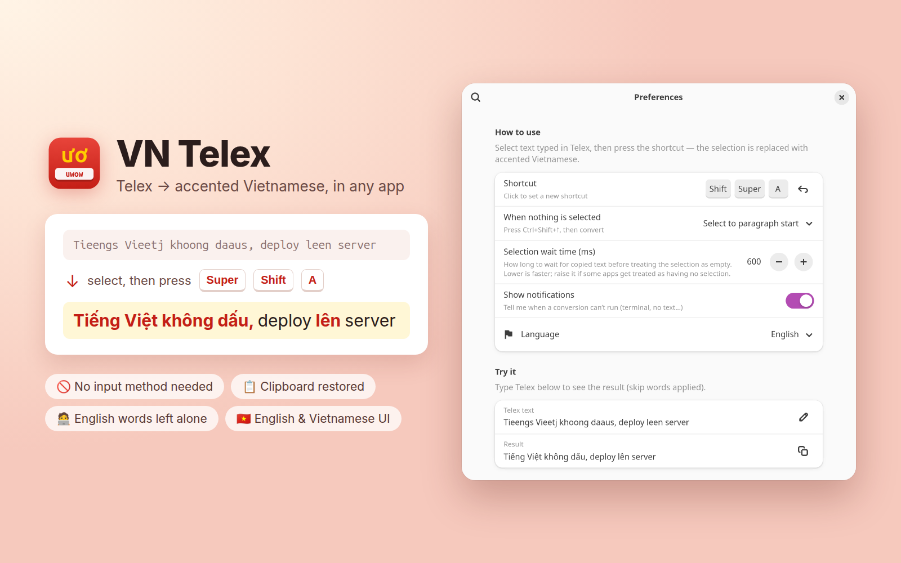

<p align="center">
  
</p>

<h1 align="center">VN Telex</h1>

<p align="center">
  🇬🇧 <b>English</b> · 🇻🇳 <a href="README.vi.md">Tiếng Việt</a>
</p>

<p align="center">
  Turn Telex text into accented Vietnamese, right where you typed it.<br>
  A GNOME Shell extension for Wayland and X11, for GNOME 46 to 50.
</p>

<p align="center">
  
</p>

---

Typed a whole sentence before you noticed your Vietnamese input method was off? Select it, press
your shortcut (for example **Super+Shift+A**), and it's fixed in place:

```
Tieengs Vieetj khoong daaus, deploy leen server
                    ↓
Tiếng Việt không dấu, deploy lên server
```

No input method needed and no copying back and forth. It works in browsers, editors, chat apps, and any
other app that supports Ctrl+C and Ctrl+V.

## Use cases

- 🧑‍💻 **English-first developers.** Your OS, editor and keyboard live in English and you don't want a
  Vietnamese IME hijacking every keystroke. Type Telex freely, convert only when you need to.
- 🙅 **No IME at all.** Skip installing and configuring IBus/Fcitx just to send the occasional Vietnamese
  message. One extension, one shortcut.
- 😅 **"Oops, the IME was off."** You typed a whole paragraph as `ddi awn cowm chuwa`? Select it, press the
  shortcut, done. No retyping.
- 🐛 **IME fighting your tools.** Autocomplete, code editors and web apps that glitch with pre-edit text
  (duplicated letters, swallowed characters) are no problem: you type plain ASCII and convert afterwards.
- 💬 **Mixed Vietnamese and tech talk.** Chatting with your team about `deploy`, `merge` and `staging` in
  Vietnamese? English words stay untouched while the Telex around them gets its accents.
- 🖥️ **Terminal and Neovim users.** Pipe text through `cli.js` or bind it to a key in Vim to write commit
  messages and notes in Vietnamese.

## Features

- **Converts in place.** It replaces the selected text in the focused app.
- **Keeps your clipboard.** Whatever you had copied, text or an image, is put back afterwards.
- **Understands mixed text.** English words such as `deploy`, `test` and `data` are left alone. Only valid
  Vietnamese syllables are converted, and a skip list you can edit handles the rest.
- **Handles an empty selection.** It can select back to the start of the paragraph and convert, ask you
  first, or do nothing.
- **Polished preferences.** A shortcut recorder, a live "Try it" preview, and a skip-word editor with search.
- **English and Vietnamese interface.** It follows your system language, or you can pick one in Preferences.
- **Works with Copyous.** If Copyous is installed, it
  is switched to incognito during a conversion, so the intermediate text stays out of your clipboard history.
- **Command-line filter.** `cli.js` uses the same engine and works in Neovim, scripts and pipes.

## Telex cheat sheet

| Type | Get | | Type | Get |
|---|---|---|---|---|
| `aa` `ee` `oo` | â ê ô | | `s` | sắc (á) |
| `aw` `ow` `uw` | ă ơ ư | | `f` | huyền (à) |
| `uow` | ươ | | `r` | hỏi (ả) |
| `dd` | đ | | `x` | ngã (ã) |
| | | | `j` | nặng (ạ) |

The tone key can go anywhere after the vowel: `vieetj` and `vietej` both give **việt**.

## Installation

```sh
git clone git@github.com:tecix/vn-telex.git ~/.local/share/gnome-shell/extensions/vn-telex@tecix
gnome-extensions enable vn-telex@tecix
```

On Wayland, log out and back in so GNOME Shell loads the new extension. On X11, you can press Alt+F2, type
`r` and press Enter instead.

No shortcut is set by default, because the extension works through the clipboard. Open Preferences
(`gnome-extensions prefs vn-telex@tecix`) and click **Shortcut** to pick one, for example **Super+Shift+A**.

To update, run `git pull` in that folder and log out and back in.

## Usage

1. Select text typed in Telex.
2. Press your shortcut.

To change the shortcut and other settings, open Preferences:

```sh
gnome-extensions prefs vn-telex@tecix
```

| Setting | Default | Description |
|---|---|---|
| Shortcut | Not set | Click the row and press a combination, for example `Super+Shift+A`. |
| When nothing is selected | Select to paragraph start | Sends Ctrl+Shift+↑ and converts the result. You can also choose *Ask first* or *Do nothing*. |
| Selection wait time | 600 ms | How long to wait for Ctrl+C to copy something before treating the selection as empty. Lower it to make *When nothing is selected* kick in faster; raise it if a slow app is wrongly treated as having no selection. |
| Fast mode (Advanced) | Off | Makes *When nothing is selected* much faster. It reacts as soon as an app copies instead of checking every 30 ms, learns how fast each app copies and waits only 2 × the slowest copy + 40 ms (at least 80 ms, at most *Selection wait time*), and runs both copy attempts in one clipboard session. If a slow app is wrongly treated as having no selection, forget the learned timings or turn it off. |
| Show notifications | On | Tells you when nothing could be converted. |
| Language | Automatic | Sets the interface language: Automatic, English or Tiếng Việt. |
| Skip words | ~50 tech terms | Words that are never converted. Each entry matches by prefix, so `test` also covers `tests` and `testing`. |

## Terminals and Neovim

Terminals don't paste with Ctrl+V, and pasting into Neovim's normal mode would run the text as commands.
For that reason, the shortcut does nothing in terminal windows. Use the command-line filter instead:

```sh
echo "Xin chaof cacs banj" | ~/.local/share/gnome-shell/extensions/vn-telex@tecix/cli.js
# Xin chào các bạn
```

To convert the visual selection in Neovim with `<leader>tv`:

```vim
xnoremap <leader>tv :!~/.local/share/gnome-shell/extensions/vn-telex@tecix/cli.js<CR>
```

`cli.js` reads the same skip list as the extension.

## How it works

1. The shortcut fires. The extension waits for you to release the modifier keys, then saves your clipboard.
2. It sends a virtual **Ctrl+C** and waits for the copied text to appear (up to *Selection wait time*).
3. The text is converted word by word. Skip words and anything that isn't a valid Vietnamese syllable are
   kept as typed.
4. It places the result on the clipboard, sends **Ctrl+V**, and then restores your original clipboard.

If nothing was copied, it falls back to the *When nothing is selected* setting.

## Project layout

```
extension.js   Shortcut, clipboard handling, virtual keyboard, dialog and notifications
prefs.js       Preferences window (libadwaita)
telex.js       Telex → Vietnamese engine (no GNOME dependencies)
i18n.js        English source strings and Vietnamese translations
cli.js         Command-line filter (gjs)
schemas/       GSettings schema
icons/         Extension icon
screenshots/   Images for the README and extensions.gnome.org
```

After you edit the schema, recompile it:

```sh
glib-compile-schemas schemas/
```

To follow the extension's logs while you test:

```sh
journalctl -f -o cat /usr/bin/gnome-shell | grep -i telex
```

## Compatibility

- GNOME Shell 46, 47, 48, 49 and 50
- Wayland and X11
- The app must support Ctrl+C and Ctrl+V. Terminals are detected and skipped.

## TODO

- [ ] 🖥️ **Terminals:** convert in place in terminal emulators (GNOME Terminal, Ptyxis, Kitty, Alacritty,
  WezTerm) using Ctrl+Shift+C / Ctrl+Shift+V instead of skipping them.
- [ ] 🦊 **Firefox extension:** convert the selection in any text field, on every OS.
- [ ] 🌐 **Chrome extension:** the same for Chrome, Edge, Brave and other Chromium browsers.

## Credits

The Telex engine is ported from [VN Textify](https://www.raycast.com/locnguyen1842/vn-textify) by Loc Nguyen
(MIT License).
